<div align="center">


# 模块雷达 ModRadar

**APK / Xposed / KernelSU 模块的静态扫描 + AI 逆向分析工具**

装一个模块之前，先看清楚它到底会干什么。

**简体中文** · [English](README_EN.md)

[](https://github.com/fjjzy/modradar/releases/latest)
[](LICENSE)
[](#安装)
[](https://kotlinlang.org)
[](https://developer.android.com/jetpack/compose)
[](#mcp-手机端逆向工具箱)
[](#从源码构建)


</div>

## 它解决什么问题

安卓上装第三方模块，风险判断基本靠「别人说能用」。包里到底声明了哪些权限、组件是不是敞开的、
会不会从远端拉代码来执行、有没有把数据传出去，普通人看不见；包一旦混淆或加固，特征匹配也基本失效。

ModRadar 做两件事：

1. **本地静态分析**：把包拆开，能确定的事实全部摆出来，**每条扣分都挂证据**（类#方法 / 字符串 / 文件 / 偏移），可以点回去看原文。
2. **AI 深挖**：混淆过的目标交给大模型，通过只读工具循环读取分析产物再下结论，不靠特征猜。

全程**只读**：不注入、不修改、不 Hook。

## 功能

| | |
|---|---|
| **扫描目标** | 一个入口四个来源：已安装应用（免 root 提取 base + split）· APK / zip 文件 · 文件夹（SAF，自动分类）· KSU / Magisk 模块（root 只读） |
| **批量排队** | 多选目标一次加入，重操作全局串行，跑完自动接下一个 |
| **能力链分析** | 追踪 `SOURCE → TRANSFORM → SINK`，专门回答「远端取文件 → 本地执行」这类问题（规则 C1–C8） |
| **native 层** | 解析 `.so` 的 ELF 动态导入表与 `DT_NEEDED`，识别 dlopen + mprotect + exec + 网络组合（C8）与 ptrace 反调试 |
| **风险评分** | 一套分数：`100 − Σ扣分`；按目标类型降噪（Xposed / KSU 模块的 Hook、改属性、挂载等本职行为只提示不扣分）；AI 复核走同一扣分通道——误报退回、低估加重（≤ 原扣分 50%）、规则外已确认发现按档位补充扣分（总封顶 −40），每条修正可一键退回 |
| **AI 研判报告** | 固定 JSON 协议输出（总体结论 → 关键判断宫格 → 关键发现 → 规则复核 → 建议），本地固定模板渲染为手机竖屏 HTML，多次研判版式一致，可导出；AI 判为误报的规则自动退回扣分并折叠 |
| **来源核验** | 与 AI 研判并发联网查 GitHub：KSU updateJson / LSPosed 模块仓库 / 包内链接 / 名称搜索找开源项目，展示 star 并可跳转；release 哈希、APK 签名（HTTP Range 只取签名块）、模块 zip 逐文件比对，判断官方原版还是修改版；识别 LSPatch 重打包与内嵌模块 |
| **证据可读** | 每条规则附「是什么 / 可能的危害 / 什么情况下正常」，API 标注中文含义；任意证据一键带入 AI 工作台追问 |
| **AI 工作台** | 流式输出 + 可折叠思考过程，手动上滑即暂停自动滚动；结论类回答附可视化卡片（宫格 / 流程 / 导图）；OpenAI 兼容 function calling；DeepSeek / OpenAI / Gemini / Claude / 硅基流动 / Ollama 预设；可拉取模型列表 |
| **MCP** | 同一份工具表同时给内置 AI、PC 端 Agent（MCP Server）和外部 MCP 工具（MCP Client）使用 |
| **导入 / 导出** | 一个 JSON 备份 AI / MCP 设置、任务历史、报告与对话；密钥默认不导出 |
| **后台与续跑** | 前台服务 + 常驻通知；原子检查点，进程被杀后从断点继续 |

## 界面

<table>
<tr>
<td align="center">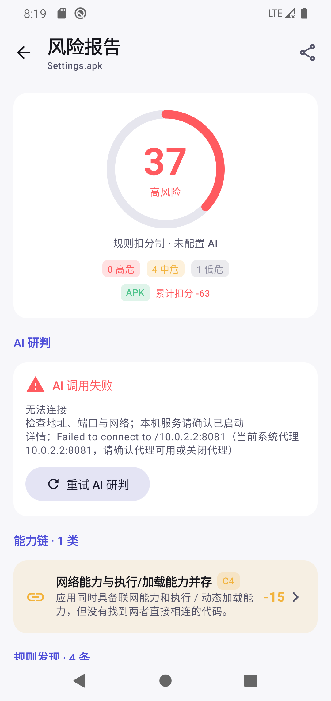<br>报告 · 单一分数（AI 修正已计入）</td>
<td align="center">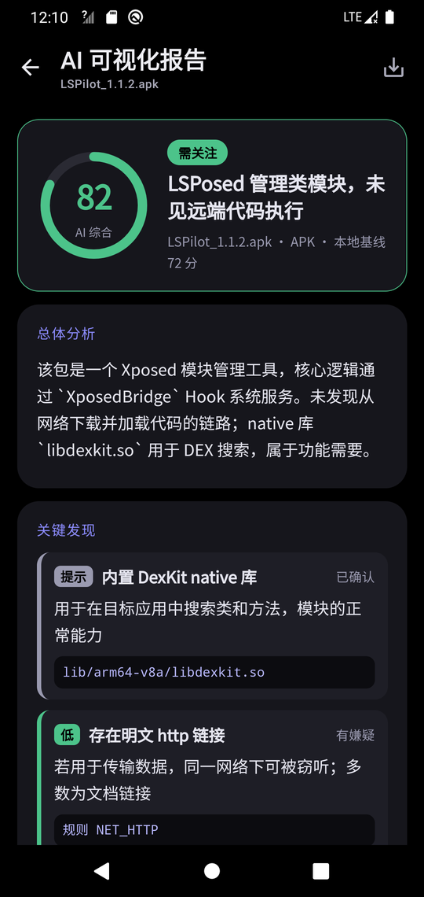<br>AI 可视化报告 · 固定模板</td>
<td align="center">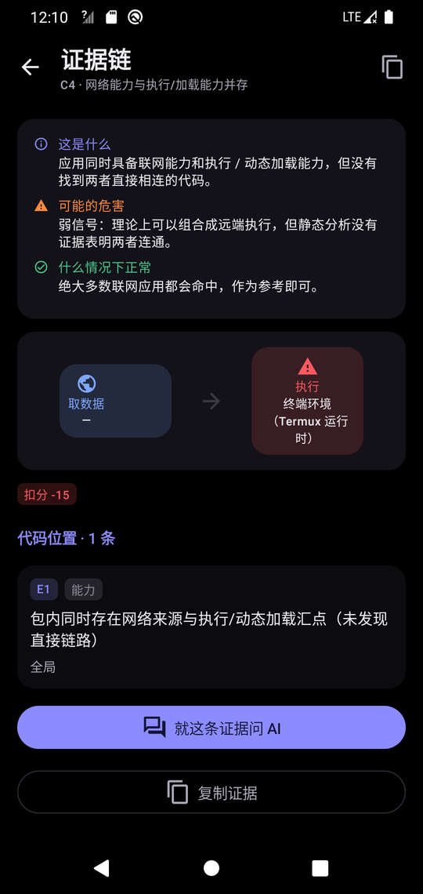<br>证据链 · 通俗解释 + 追问</td>
<td align="center">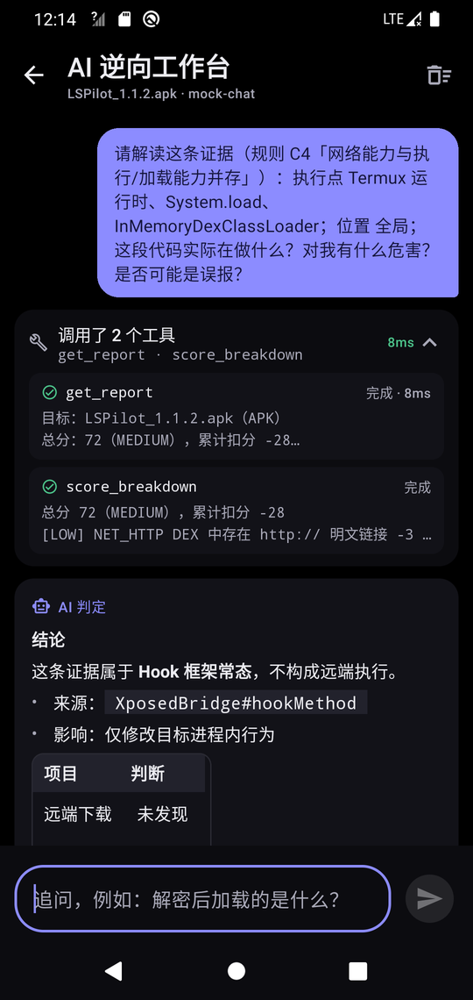<br>工作台 · 工具调用折叠</td>
</tr>
<tr>
<td align="center">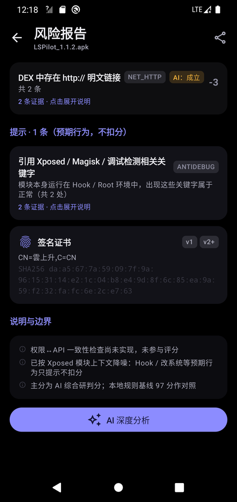<br>模块上下文降噪 · 只提示</td>
<td align="center">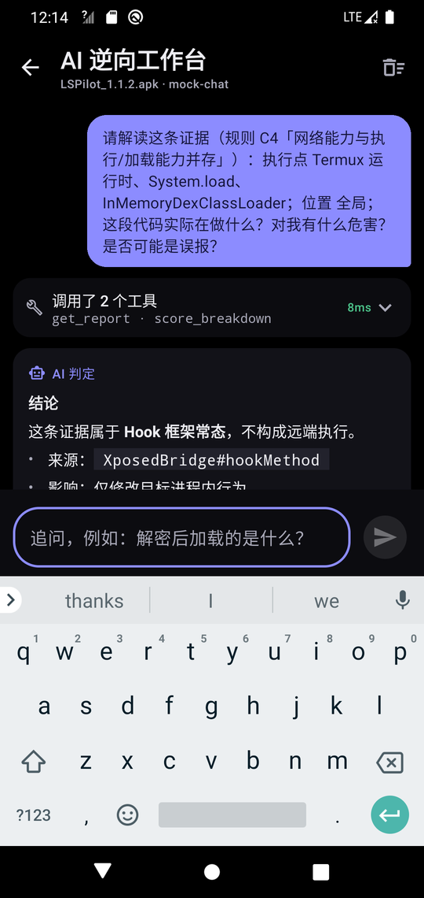<br>输入栏贴合键盘</td>
<td align="center">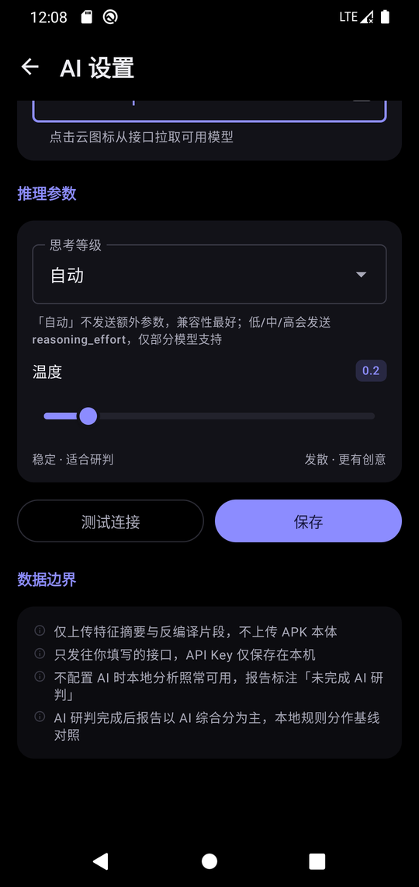<br>AI 设置 · 温度滑块</td>
<td align="center">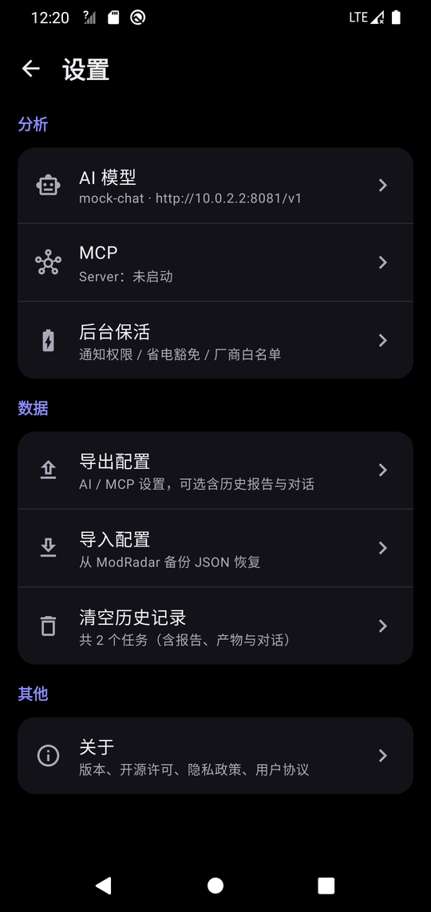<br>设置 · 导入 / 导出</td>
</tr>
<tr>
<td align="center">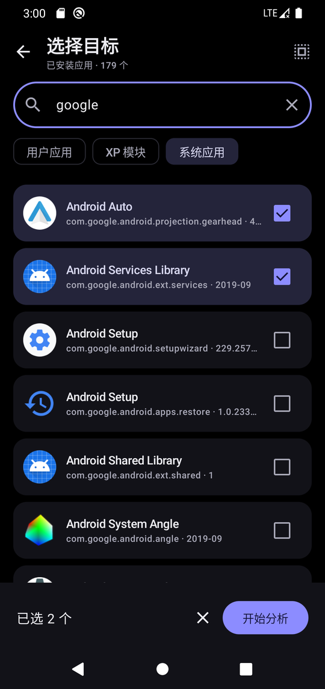<br>已安装应用 · 多选批量</td>
<td align="center">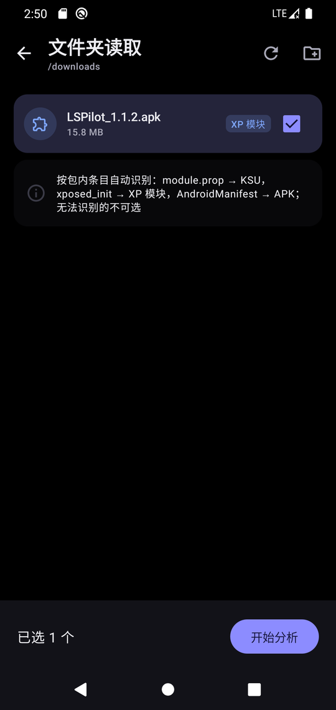<br>文件夹 · 自动分类</td>
<td align="center">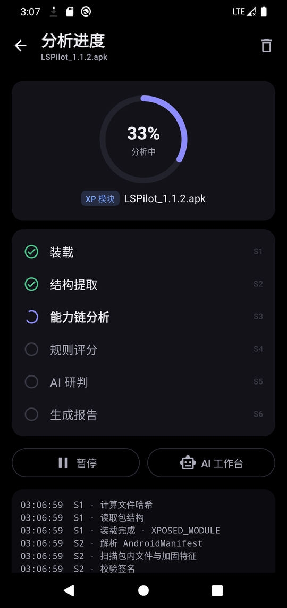<br>分析进度 · 实时日志</td>
<td align="center">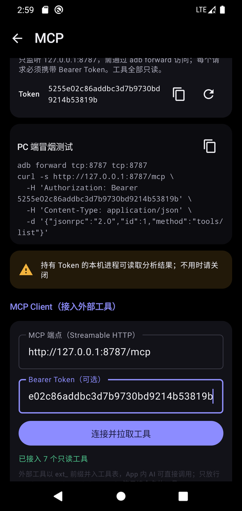<br>MCP Server / Client</td>
</tr>
</table>

以上均为真机界面截图（Android 10 模拟器，纯黑主题；Android 12+ 自动跟随系统动态取色）。设计原型见 [`docs/ui/`](docs/ui/README.md)。

## 分析流水线

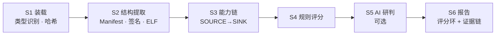

不配置 AI 时 S5 自动降级，报告照常生成并标注「未完成 AI 研判」。AI 不输出独立分数，只通过误报退回 / 加重 / 补充扣分修正同一套扣分结果。

### 评分速览

| 等级 | 分数 | 典型扣分项 |
|---|---|---|
| 低 | ≥ 80 | 签名问题 −5 ~ −25 · 无保护的 exported 组件 −8 ~ −30 |
| 中 | 60–79 | 危险权限组合 −20 · 明文流量 −10 · debuggable −10 |
| 较高 | 40–59 | 跨方法调用链可达 C2 −25 · native 可疑组合 C8 −20 |
| 高 | < 40 | 同方法取数据并执行 C1 −35 · 解密后加载 C5 −30 · KSU 危险脚本 C7 −30 · 加固不可审计 C6 −25 |

完整规则与权重见 [`docs/计划.md`](docs/计划.md)。

## 安装

到 [Releases](https://github.com/fjjzy/modradar/releases/latest) 下载 APK，支持 **Android 7.0 及以上**。

## 使用

1. 首页点 **扫描目标**（或直接点下方「已安装 / 文件 / 文件夹 / KSU 模块」快捷方式），可多选。
2. 分析在后台跑，进度页能看到每个阶段和实时日志；在进度页看着跑完会直接跳到报告。
3. 报告顶部先看 AI 总体结论，点「AI 可视化报告」看完整版；能力链进入**证据链**，看通俗解释与具体类#方法，点「就这条证据问 AI」继续追问。
4. 想追问就点 **AI 深度分析**。先在 设置 → AI 模型 里选服务商、填 Key，点「测试连接」确认可用。

<details>
<summary><b>AI 配置常见问题</b></summary>

- **地址怎么填？** 填到版本号为止，如 `https://api.deepseek.com/v1`。只写域名会自动补 `/v1`，误粘的 `/chat/completions` 会自动去掉，输入框下方实时显示实际请求地址。
- **Key 粘贴了 `Bearer ` 前缀或换行？** 保存时自动清理。
- **测试失败？** 错误会被分类成「Key 无效 / 地址或模型不存在 / 额度不足 / 超时 / 域名解析失败 / 系统代理不可达 …」并给出修复建议；429 / 5xx / 超时自动退避重试 2 次。
- **模型名不确定？** 点模型框右侧的云图标，从接口拉取可用模型列表。
- **局域网 Ollama？** 支持 http 明文地址；公网 http 会提示 Key 可能被窃听。

</details>

## MCP：手机端逆向工具箱

工具在 App 内**只定义一次**，三处复用：

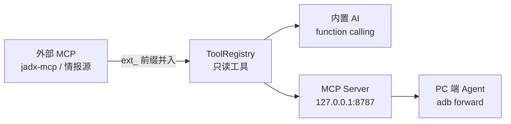

**Server**：设置 → MCP 打开开关，复制 Token，在 PC 上：

```bash
adb forward tcp:8787 tcp:8787
curl -s http://127.0.0.1:8787/mcp \
  -H "Authorization: Bearer <token>" \
  -d '{"jsonrpc":"2.0","id":1,"method":"tools/list"}'
```

先调 `list_tasks` 拿 `task_id`，再调 `capability_chain` / `score_breakdown` / `native_imports` 等。
Server 默认关闭，**只绑定 127.0.0.1**，每个请求必须带 Bearer Token，否则返回 401。

**Client**：填入外部 MCP 端点（Streamable HTTP），只放行 `get / list / search / read / decompile …` 等只读命名的工具。

## 从源码构建

```bash
gradle :app:testDebugUnitTest   # 单元测试（112 个）
gradle :app:assembleDebug       # 调试包
./build.sh                      # 发布包：assembleRelease → zipalign → apksigner
```

`build.sh` 需要 keystore，路径与口令用环境变量 `KEYSTORE` / `KS_PASS` / `KEY_ALIAS` 覆盖。

| 层 | 技术 |
|---|---|
| UI | Kotlin · Jetpack Compose · Material 3 · Navigation 3 · Material Icons |
| 逆向 | [dexlib2](https://github.com/JesusFreke/smali) · [DexKit](https://github.com/LuckyPray/DexKit) · 自研 AXML / ELF 解析 |
| 数据 | Room · kotlinx-serialization |
| 网络 | OkHttp（AI 客户端、MCP Client、GitHub 来源核验）· 原生 Socket（MCP Server） |

## 常见问题

**一定要 root 吗？** 不用。只有「KSU / Magisk 模块」入口需要 root，且只执行 `ls` / `cat` / `test` 三类只读命令。

**报告说「不可审计」？** 包被加固（壳 / VMP），真实 DEX 是加密的，静态看不到。ModRadar 会直接标出来并计入风险，而不是假装扫干净了。

**AI 会把 APK 传上去吗？** 不会。只发特征摘要与工具返回的片段，**不上传包本体**；Key 只存本机。

**能卸载 / 停用模块吗？** 不能，也不打算做。ModRadar 只读。

## 已知边界

- 加固目标静态拆不开，只标「不可审计」；动态脱壳、Hook 计划放到 v2
- 权限 ↔ API 一致性检查、jadx 单类反编译工具尚未接入
- Xposed 模块的激活状态没有公开 API，界面不做猜测
- 截图来自模拟器；真机兼容性仍需更多反馈

## 隐私与许可

本地优先、零遥测，没有账号、统计或广告 SDK。详见 [隐私政策](PRIVACY.md) · [用户协议](TERMS.md)。

[GPL-3.0](LICENSE)。仅用于分析**你有权处理**的应用与模块，禁止破解他人应用或绕过付费。
