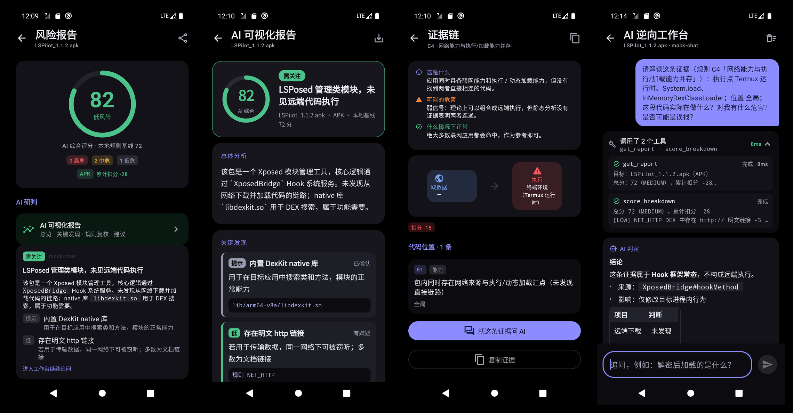
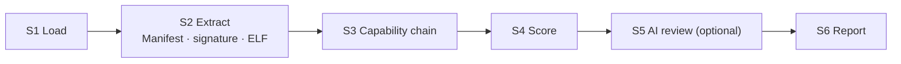

<div align="center">


# ModRadar

**Static scanning + AI-assisted reverse engineering for APKs, Xposed modules and KernelSU / Magisk modules**

Know what a module actually does before you install it.

[简体中文](README.md) · **English**

[](https://github.com/fjjzy/modradar/releases/latest)
[](LICENSE)
[](#install)
[](https://developer.android.com/jetpack/compose)
[](#mcp)



</div>

## What it does

1. **Local static analysis**: unpacks the target and lists every verifiable fact. Each deduction carries evidence (class#method, string, file, offset) you can jump back to.
2. **AI deep dive**: for obfuscated targets, an LLM reads the analysis artifacts through a read-only tool loop instead of guessing from signatures.

Everything is **read-only**: no injection, no modification, no hooking.

## Features

| | |
|---|---|
| **Inputs** | APK / zip files · installed apps (base + split APKs, no root) · a SAF folder (auto-classified) · KSU / Magisk modules (root, read-only) |
| **Batch queue** | Pick many targets at once; heavy work runs serially |
| **Capability chains** | Traces `SOURCE → TRANSFORM → SINK` to answer "does it download and execute code?" (rules C1–C8) |
| **Native layer** | Parses ELF dynamic imports and `DT_NEEDED`; flags dlopen + mprotect + exec + network (C8) and ptrace anti-debugging |
| **Risk score** | Local rules (`100 − Σ deductions`) as the baseline, denoised by target type (hooking / prop / mount behaviour of Xposed and KSU modules is shown as a hint, not deducted); once AI review is done, the AI overall score becomes the headline score |
| **AI report** | Fixed JSON protocol (verdict → key-judgement grid → key findings → rule review → advice) rendered by a fixed, phone-first local HTML template, consistent across runs, exportable; rules the AI marks as false positives get their deduction refunded and are collapsed |
| **Provenance check** | Runs alongside the AI review: finds the open-source repo on GitHub (KSU updateJson / LSPosed module repo / in-package links / name search), shows stars with a link, then compares release hashes, APK signing certificates (HTTP Range fetches only the signing block) or module zips file by file to tell official builds from modified ones; detects LSPatch repackaging and embedded modules |
| **Readable evidence** | Every rule explains what it is, possible harm and when it is benign; any evidence can be sent to the AI workspace as a follow-up question |
| **Import / export** | One JSON backup for AI / MCP settings, task history, reports and chats; secrets excluded by default |
| **AI workspace** | Streaming output with collapsible reasoning (scrolling up pauses auto-scroll); analytical answers end with a visual card (grid / flow / mind map); OpenAI-compatible function calling with presets for DeepSeek / OpenAI / Gemini / Claude / SiliconFlow / Ollama, model list fetching, classified errors with fixes |
| **MCP** | One tool registry shared by the in-app AI, PC agents (MCP Server) and external MCP tools (MCP Client) |
| **Background & resume** | Foreground service with progress notification; atomic checkpoints survive process death |

## Pipeline



Without AI configured, S5 degrades gracefully and the report is marked "AI review not completed". When AI review completes, its overall score becomes the headline score; the local baseline is kept for comparison.

## Install

Download the APK from [Releases](https://github.com/fjjzy/modradar/releases/latest). Android 7.0+.

## MCP

Enable the server in Settings → MCP and copy the token. It binds to **127.0.0.1 only** and rejects requests without the Bearer token (401).

```bash
adb forward tcp:8787 tcp:8787
curl -s http://127.0.0.1:8787/mcp \
  -H "Authorization: Bearer <token>" \
  -d '{"jsonrpc":"2.0","id":1,"method":"tools/list"}'
```

Call `list_tasks` first to get a `task_id`, then `capability_chain`, `score_breakdown`, `native_imports`, etc.
The client side imports tools from an external Streamable-HTTP MCP endpoint; only read-only names (`get/list/search/read/decompile…`) are accepted, prefixed with `ext_`.

## Build

```bash
gradle :app:testDebugUnitTest   # 112 unit tests
gradle :app:assembleDebug
./build.sh                      # release: assembleRelease → zipalign → apksigner
```

## Limitations

- Packed / VMP targets are reported as "not auditable"; dynamic unpacking is planned for v2
- Permission ↔ API consistency and single-class jadx decompilation are not wired in yet
- Screenshots are from an emulator

## Privacy & License

Local-first, zero telemetry. See [PRIVACY.md](PRIVACY.md) and [TERMS.md](TERMS.md) (Chinese).

[GPL-3.0](LICENSE). Only analyze apps and modules you are authorized to inspect.
