# ModRadar UI 原型图（12 屏）

[返回主 README](../../README.md) · [English](../../README_EN.md)

> **这里是设计阶段的 AI 生成原型图，不是真实界面。**
> 真实界面截图（模拟器实拍）见 [`../screenshots/`](../screenshots/)，总览：[gallery.png](../screenshots/gallery.png)。

> 依据 [../计划.md](../计划.md) 的界面清单生成，覆盖全部界面与关键运行时状态。
> 生成方式：`work-image-gen` / `sws-gemini`（Nano Banana Pro），2K 竖屏 9:16。
> Prompt 源文件：[prompts.py](prompts.py) ｜ 批量脚本：[gen_ui.py](gen_ui.py)
> 合成脚本：[../../tools/make_assets.py](../../tools/make_assets.py)（图标 + 预览图，可重复执行）

## 速览

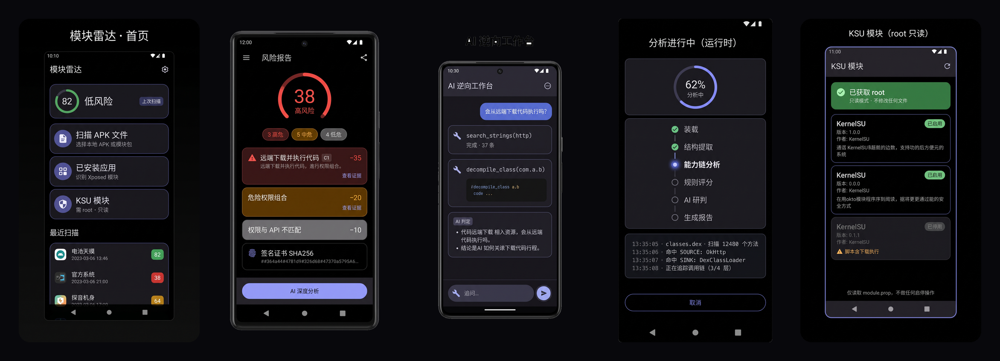

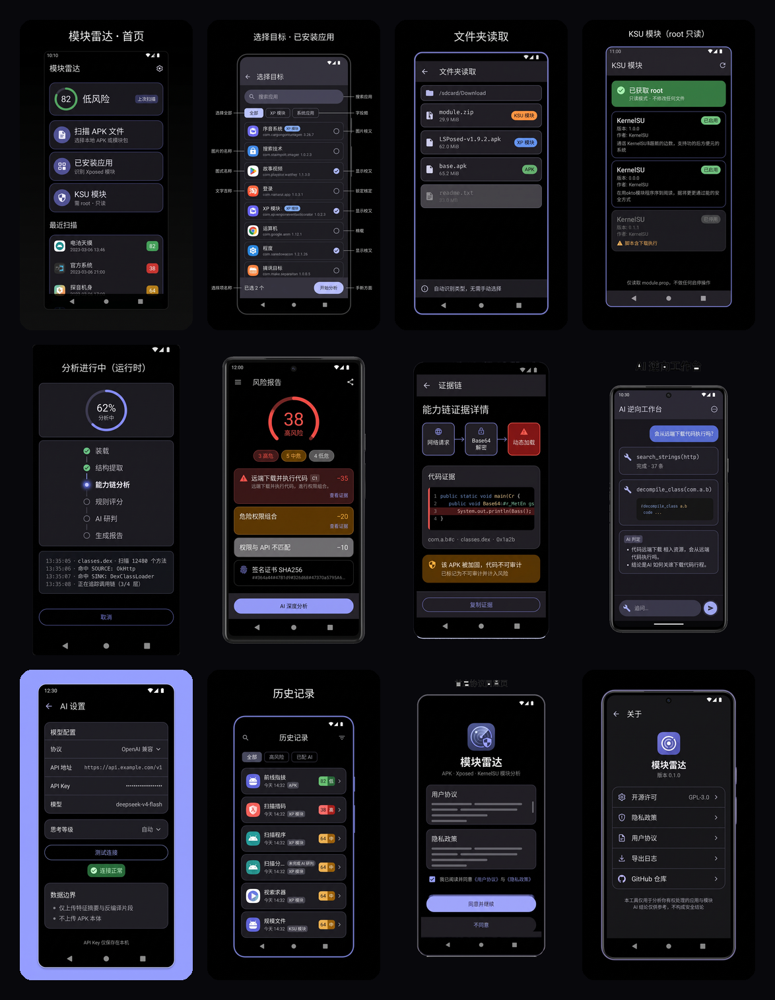

## 视觉基调

纯黑深色主题（#000000）+ Material 3 + 圆角卡片 + 蓝紫强调色，对齐 gkd-plus 的风格取向。

> 说明：部分出图原本带浅色外框，合成预览时已把与边缘连通的浅色背景泛洪成深色底，
> 因此单屏原图与预览图底色可能不同。

---

## 01 首页 Dashboard

扫描入口三卡片（APK 文件 / 已安装应用 / KSU 模块）+ 上次扫描评分环 + 最近扫描列表。

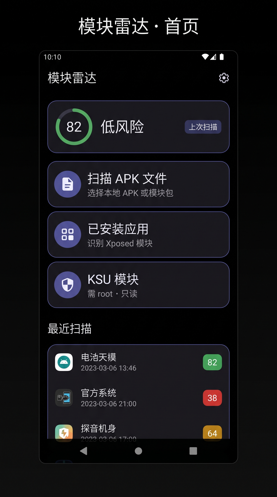

## 02 选择目标 · 已安装应用

搜索 + 筛选 chip（全部 / XP 模块 / 系统应用）+ 应用列表（含 XP 模块标记）+ 底部「已选 N 个 · 开始分析」。

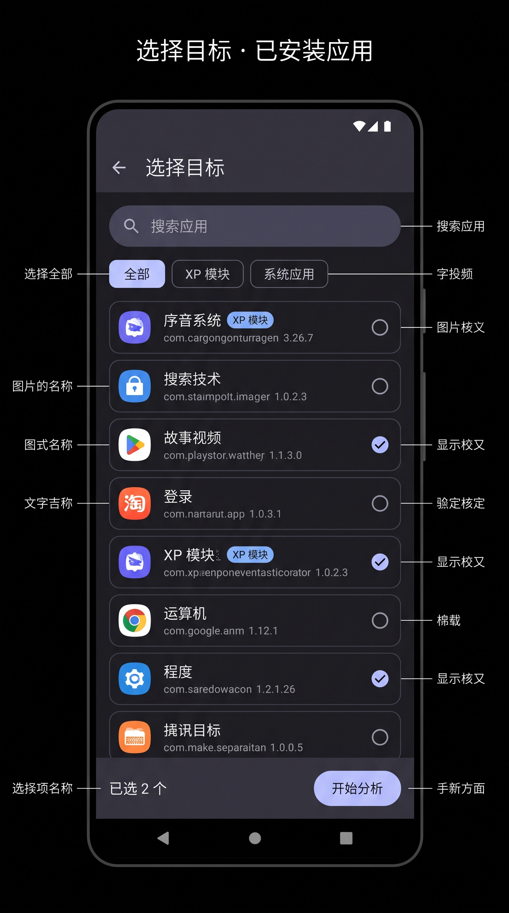

## 03 文件夹读取（SAF）

面包屑路径 + 文件列表 + 类型标签（APK / XP 模块 / KSU 模块），自动识别类型。

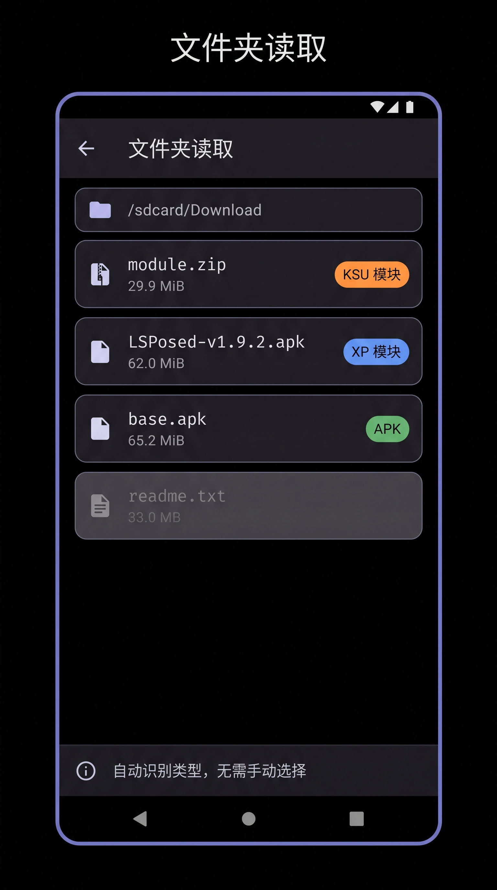

## 04 KSU 模块（root 只读）

root 状态横幅（只读模式）+ 模块卡片（module.prop 信息、启用状态）+ 危险脚本告警。

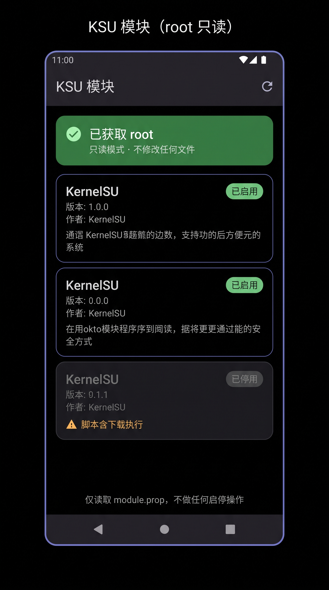

## 05 分析进行中（运行时状态）

62% 进度环 + S1–S6 阶段 stepper（已完成 / 进行中 / 待执行）+ 实时日志（SOURCE / SINK 命中、调用链追踪）。

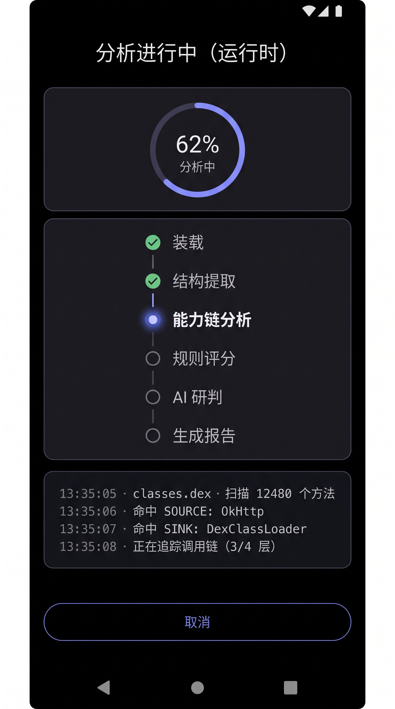

## 06 风险报告

评分环 38 高风险 + 分级统计 chip + findings 卡片（含规则编号、扣分、查看证据入口）+ SHA256 信息卡 + AI 深度分析入口。

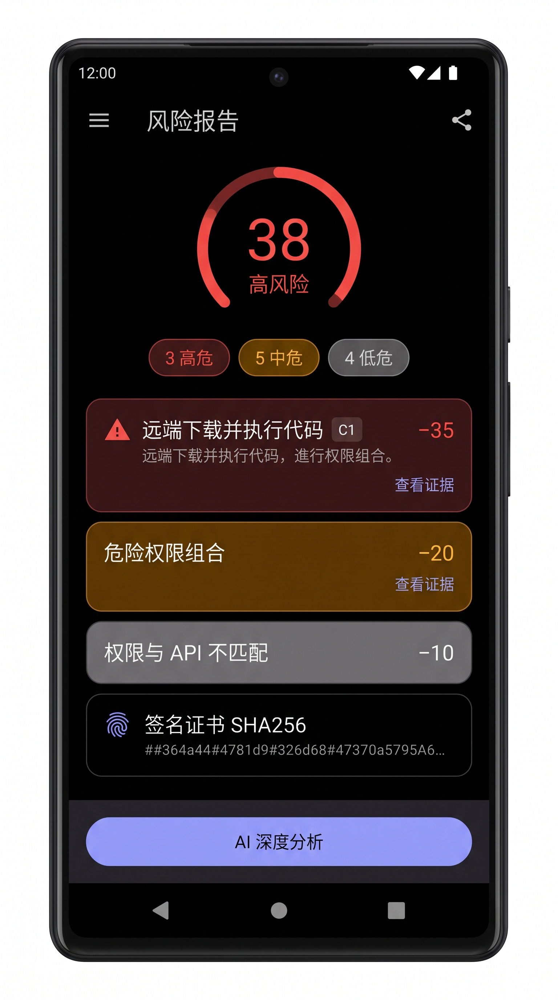

## 07 能力链证据详情

三节点链路图（网络请求 → Base64 解密 → 动态加载）+ 代码证据块 + 加固「不可审计」告警。

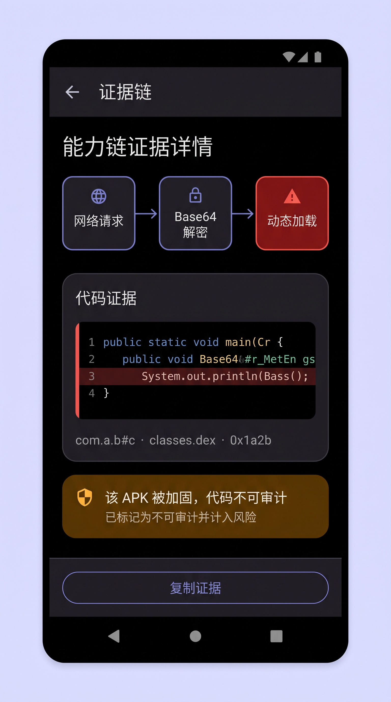

## 08 AI 逆向工作台（运行时状态）

对话流 + 工具调用卡片（search_strings / decompile_class）+ AI 判定结论 + 追问输入栏。

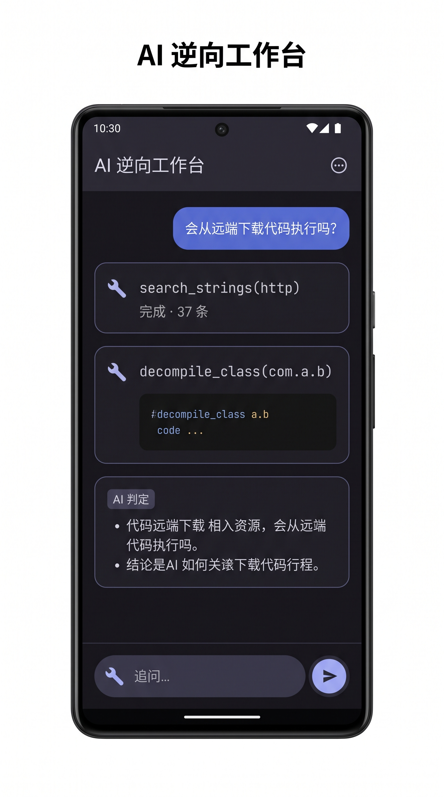

## 09 AI 设置

协议 / API 地址 / API Key / 模型 / 思考等级 + 测试连接（成功态）+ 数据边界说明。

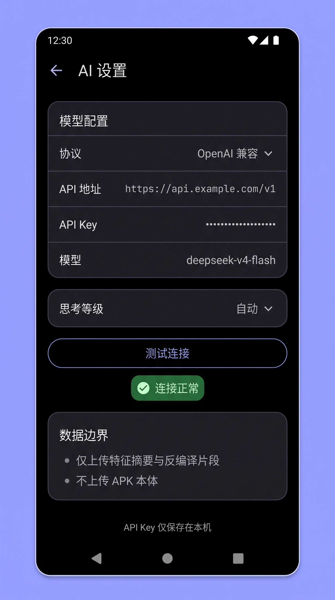

## 10 历史记录

筛选 chip + 历史行（目标类型标签、评分徽章、「未完成 AI 研判」标记）。

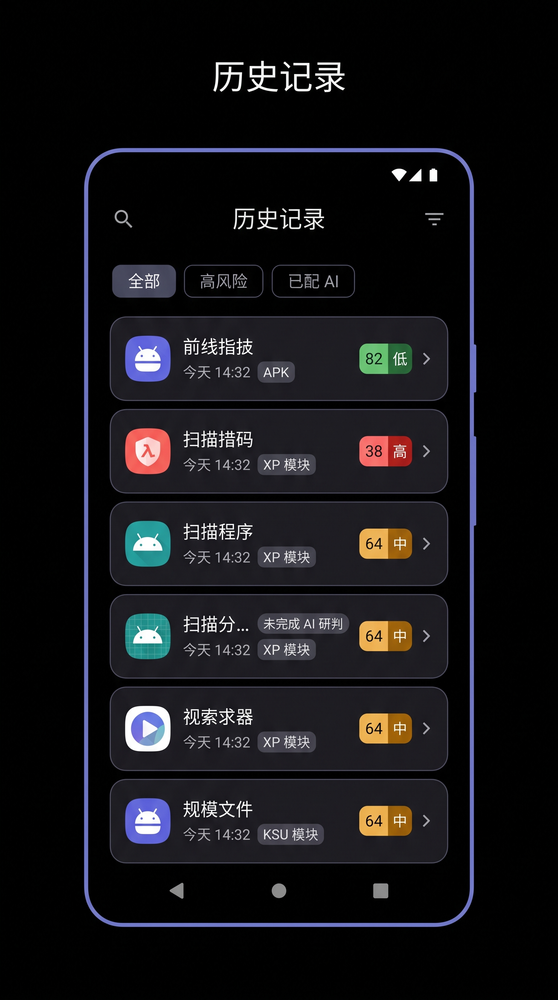

## 11 首启协议同意页

用户协议 + 隐私政策 + 勾选同意 + 同意/不同意。

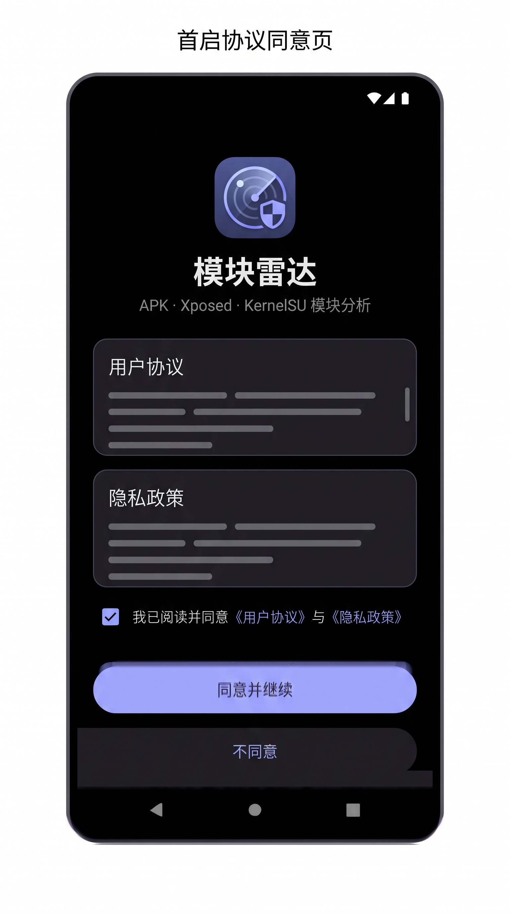

## 12 关于

版本、开源许可（GPL-3.0）、隐私政策、用户协议、导出日志、GitHub 仓库、免责声明。

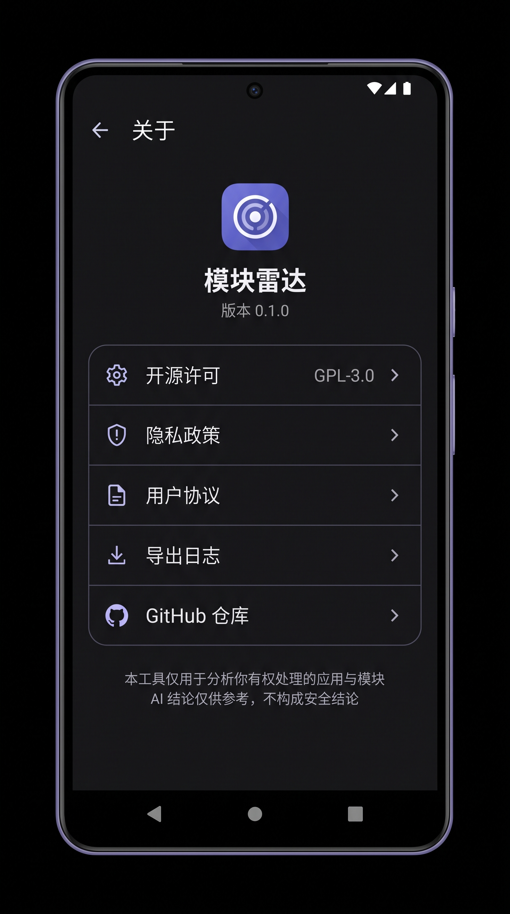

---

## 复现方式

```bash
cd modradar/docs/ui
ANTHROPIC_AUTH_TOKEN="$(cat ~/.config/sws-gemini/token)" python3 gen_ui.py          # 全部
ANTHROPIC_AUTH_TOKEN="$(cat ~/.config/sws-gemini/token)" python3 gen_ui.py 06-report  # 单屏重出
```

已存在的图片会被跳过（可断点续跑）。

## 已知限制

- 图像模型对密集中文文案会出现个别错字（如长句结论、代码注释）；已在 prompt 中控制文字密度，重点屏已重出。
- 部分图带手机外框与浅色留白，部分为满屏；这是模型对「screenshot」理解的差异，不影响界面结构评审。
- 这些是设计意图示意图，不是真实运行截图。
